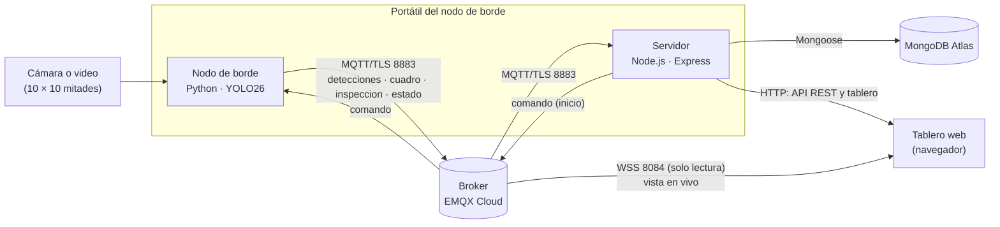

# Sistema IoT para el ensayo de corte de cacao

Sistema IoT que automatiza el **ensayo de corte de granos de cacao CCN-51** según la **NTE INEN 176** (Ecuador). Un detector **YOLO26** (Ultralytics) clasifica las mitades de grano cortado en cuatro clases: **fermentado, violeta, pizarroso y mohoso**. Cada inspección analiza 30 s de video de una cuadrícula de 10 × 10 mitades, publica los resultados por MQTT y los guarda en MongoDB. Un tablero web muestra la inspección en vivo, el historial por lote y la validación frente a una experta.

Los resultados se publicarán en un artículo científico. Por eso cada número que muestra el sistema se puede exportar a CSV y reproducir con los scripts de este repositorio (sección [Reproducir las tablas del artículo](#reproducir-las-tablas-del-artículo)).

> El documento de requisitos ([PROMPT.md](PROMPT.md)) menciona HiveMQ Cloud. El sistema usa **EMQX Cloud** con los mismos puertos de MQTT/TLS (8883) y WSS (8084, ruta `/mqtt`).

---

## Contenido

- [Arquitectura](#arquitectura)
- [Estructura del repositorio](#estructura-del-repositorio)
- [Requisitos](#requisitos)
- [Instalación](#instalación)
- [Configuración](#configuración)
- [Uso](#uso)
- [Reproducir las tablas del artículo](#reproducir-las-tablas-del-artículo)
- [Definiciones y métodos](#definiciones-y-métodos)
- [Referencia técnica](#referencia-técnica)
- [Seguridad](#seguridad)
- [Solución de problemas](#solución-de-problemas)
- [Datos y créditos](#datos-y-créditos)

---

## Arquitectura



| Componente | Tecnología | Función |
|---|---|---|
| **Nodo de borde** ([edge/](edge/)) | Python 3.11+, Ultralytics, OpenCV, paho-mqtt | Procesa el video con YOLO26 (CUDA si existe; si no, CPU), calcula el resultado de cada inspección de 30 s y lo publica por MQTT/TLS (8883). |
| **Servidor** ([servidor/](servidor/)) | Node.js 20+, Express, Mongoose, MQTT.js | Recibe los resultados por MQTT/TLS, mide la red IoT, guarda en MongoDB Atlas, expone la API REST y sirve el tablero. |
| **Tablero web** ([servidor/public/](servidor/public/)) | HTML, CSS y JavaScript sin framework, Chart.js, MQTT.js | Vista en vivo por WSS (8084), lotes, detalle de inspección y validación. |

## Estructura del repositorio

```
edge/          main.py, pipeline.py, mqtt_cliente.py, cuadricula.py, config.yaml
servidor/      server.js, modelos/, rutas/, public/ (tablero) y módulos auxiliares
herramientas/  benchmark.py, evaluar_modelos.py, prueba_calculos.py, calculos.py,
               conteos_experta.csv, plantilla_posiciones.csv
models/        yolo26n.pt, yolo26s.pt, yolo26m.pt   (no se versionan)
videos/        Prueba_1_Cacao.mp4, Prueba_2_Cacao.mp4, Prueba_3_Cacao.mp4   (no se versionan)
resultados/    salidas del nodo, del benchmark y de la evaluación   (no se versiona)
.env.example   plantilla de secretos (el .env real no se versiona)
requirements.txt   dependencias de Python con versiones exactas
data.yaml      dataset de Roboflow (clases y particiones)
```

## Requisitos

- **Windows 11** (también funciona en Linux; la evaluación de modelos corre en Google Colab).
- **Python 3.11 o superior** (probado con 3.12.9).
- **Node.js 20 o superior** (probado con 24.16.0).
- Una cuenta de **EMQX Cloud** (plan Serverless) y un clúster de **MongoDB Atlas** (el plan gratuito M0 alcanza: cada inspección ocupa unos 200 KB).
- Archivos que se entregan aparte (no están en el repositorio):
  - `models/yolo26n.pt`, `models/yolo26s.pt`, `models/yolo26m.pt`: los modelos entrenados;
  - `videos/Prueba_1_Cacao.mp4`, `Prueba_2_Cacao.mp4`, `Prueba_3_Cacao.mp4`: las tres pruebas de validación.

Versiones con las que se obtuvieron los resultados: Python 3.12.9, torch 2.15.0 (CPU), ultralytics 8.4.208, OpenCV 5.0.0, paho-mqtt 2.2.0; Node.js 24.16.0, Express 5.3.0, Mongoose 9.12.1, MQTT.js 5.16.1, Chart.js 4.6.1.

## Instalación

Todos los comandos se escriben en **PowerShell**, desde la carpeta del proyecto. Escriba un comando por línea y pulse Enter después de cada uno.

**1. Descargar el proyecto**

```powershell
git clone https://github.com/updatedtechnology15-collab/Sistema_IoT_granos_cacao.git
cd Sistema_IoT_granos_cacao
```

**2. Entorno de Python**

```powershell
python -m venv .venv
.venv\Scripts\python.exe -m pip install --upgrade pip
.venv\Scripts\python.exe -m pip install -r requirements.txt
```

La instalación ocupa unos 1,5 GB. Si el disco C: está lleno, cree el entorno en otra unidad y enlácelo como `.venv`; así todos los comandos de este README siguen sirviendo:

```powershell
python -m venv D:\venvs\sistema_iot_cacao
New-Item -ItemType Junction -Path .venv -Target D:\venvs\sistema_iot_cacao
```

Con una GPU NVIDIA: instale antes `torch==2.15.0` y `torchvision==0.29.2` con CUDA desde [pytorch.org](https://pytorch.org/get-started/locally/) y después `requirements.txt`. El nodo detecta CUDA solo (`dispositivo: auto`).

**3. Dependencias del servidor**

```powershell
cd servidor
npm.cmd ci
cd ..
```

`npm ci` instala exactamente las versiones de `package-lock.json`. Se escribe `npm.cmd` para evitar el bloqueo de scripts de PowerShell (ver [Solución de problemas](#solución-de-problemas)).

**4. Modelos y videos**

Cree las carpetas `models` y `videos` en la raíz del proyecto y copie ahí los archivos. Un archivo `.pt` **no se descomprime**: si al descargarlo quedó como `yolo26s.pt.zip`, solo cámbiele el nombre a `yolo26s.pt`.

**5. Secretos y configuración**: siga la sección siguiente.

## Configuración

### Secretos: `.env`

Copie `.env.example` como `.env` y complete los valores. **El archivo `.env` nunca se sube a git.**

| Variable | Descripción |
|---|---|
| `MQTT_HOST` | Dirección del despliegue de EMQX Cloud, sin protocolo ni puerto. |
| `MQTT_PORT_TLS` | 8883: MQTT sobre TLS (nodo y servidor). |
| `MQTT_PORT_WSS`, `MQTT_WSS_PATH` | 8084 y `/mqtt`: MQTT sobre WebSocket seguro (tablero). |
| `EDGE_USER`, `EDGE_PASS` | Credencial del nodo de borde. |
| `SERVIDOR_USER`, `SERVIDOR_PASS` | Credencial del servidor. |
| `TABLERO_USER`, `TABLERO_PASS` | Credencial de solo lectura que el servidor entrega al navegador en `GET /api/config/mqtt`. |
| `MONGODB_URI` | Cadena de conexión de MongoDB Atlas, con el nombre de la base (`/cacao`). |
| `PUERTO_HTTP` | Puerto del servidor web (3000). |
| `HOST_HTTP` | `127.0.0.1` (recomendado): solo este equipo puede abrir el tablero. Con `0.0.0.0` se abre a toda la red, y la API no tiene autenticación. |

### EMQX Cloud

1. En **Access Control → Authentication**, cree los usuarios `edge`, `servidor` y `tablero` con contraseñas largas.
2. En **Access Control → Authorization**, limite cada usuario. Esto es importante porque la credencial `tablero` llega a cualquier navegador que abra el tablero:

| Usuario | Puede publicar | Puede suscribirse |
|---|---|---|
| `edge` | `cacao/est01/estado`, `cacao/est01/detecciones`, `cacao/est01/cuadro`, `cacao/est01/inspeccion` | `cacao/est01/comando` |
| `servidor` | `cacao/est01/comando` | `cacao/est01/#` |
| `tablero` | nada | `cacao/est01/#` |

### MongoDB Atlas

1. Cree un usuario de base de datos con permiso **readWrite** solo sobre la base `cacao`.
2. En **Network Access**, permita solo la IP del equipo que corre el servidor (evite `0.0.0.0/0`).
3. Copie la cadena de conexión (**Connect → Drivers**) en `MONGODB_URI` y agregue `/cacao` antes de `?`.

### Parámetros: `edge/config.yaml`

| Clave | Valor | Significado |
|---|---|---|
| `estacion_id` | `est01` | Los tópicos son `cacao/<estacion_id>/...`. |
| `modelo` | `models/yolo26s.pt` | Modelo del nodo (también `yolo26n.pt` y `yolo26m.pt`). |
| `dispositivo` | `auto` | `auto` usa CUDA si existe; si no, la CPU. También `cpu` o `cuda`. |
| `imgsz`, `conf` | 640, 0.45 | Tamaño de entrada y umbral de confianza. |
| `agnostic_nms` | `false` | `false`: cabeza de extremo a extremo de YOLO26, sin NMS. `true`: NMS agnóstico a la clase. |
| `fuente` | ruta, índice o URL | Video, cámara (`0`, `1`…) o URL (`rtsp://…`). Se puede cambiar con `--fuente`. |
| `fps_fuente_defecto` | 30 | fps que se suponen si la fuente no los informa. |
| `fps_operacion` | 5 | Se procesa 1 de cada `round(fps_fuente / 5)` cuadros. |
| `ventana_s` | 30 | Duración de cada inspección. |
| `cuadros_calentamiento` | 20 | Cuadros iniciales que no cuentan para la latencia. |
| `area_min_frac`, `area_max_frac` | 0.0012, 0.12 | Se descartan las cajas con área fuera de ese rango (fracción del cuadro). |
| `fps_cuadro_vivo`, `calidad_jpeg_vivo`, `lado_max_vivo` | 1, 60, 960 | Cuadro en vivo para el tablero. |
| `calidad_jpeg_representativo` | 85 | Imagen anotada que se guarda en MongoDB. |
| `mqtt_keepalive_s` | 30 | El broker publica «desconectado» si no oye al nodo en 1,5 × este tiempo. |
| `carpeta_resultados` | `resultados` | Carpeta de las copias locales. |

## Uso

**Forma rápida (Windows):** doble clic en **`iniciar_sistema.bat`**, en la carpeta del proyecto. Abre una ventana para el servidor y otra para el nodo, y después el tablero en el navegador. Para detener el sistema, cierre las dos ventanas. Si una ventana muestra un error, la tabla de [Solución de problemas](#solución-de-problemas) indica qué hacer.

**Desde VS Code:** el proyecto indica a VS Code que use el Python de `.venv`, así que el botón ▶ sobre `edge/main.py` arranca el nodo. El servidor debe estar corriendo aparte.

**Forma manual:** se necesitan **dos terminales abiertas al mismo tiempo**. Para detener cada programa, pulse Ctrl+C.

**Terminal 1: servidor**

```powershell
cd servidor
node server.js
```

Está listo cuando muestra `Servidor web en http://localhost:3000` y `MQTT conectado`.

**Terminal 2: nodo de borde**

```powershell
.venv\Scripts\python.exe edge\main.py
```

Está listo cuando muestra `Esperando comandos en cacao/est01/comando`. Opciones:

- `--fuente videos\Prueba_2_Cacao.mp4`: cambia la fuente de video (también un índice de cámara o una URL).
- `--lote L-001`: hace **una** inspección por consola, la publica y termina, sin usar el tablero.

**Tablero**: abra <http://localhost:3000> en el navegador.

1. En la cabecera deben aparecer en verde «Nodo en línea · listo» y «Broker conectado».
2. **Lotes**: cree el lote (identificador, origen, operador).
3. **En vivo**: elija el lote y pulse **Iniciar inspección de 30 s**. Verá el video con las cajas, los conteos, la latencia y la barra de progreso.
4. Al terminar, pulse **ver detalle**: imagen anotada, conteos, comparación con la NTE INEN 176, rendimiento y red IoT.
5. **Validar**: ingrese los conteos de la experta (para las tres pruebas se precargan desde [herramientas/conteos_experta.csv](herramientas/conteos_experta.csv)) o suba un CSV por posición, y pulse **Calcular y guardar la validación**.
6. **Exportar CSV**: en **Lotes** (todo o por lote), en el detalle y en la validación.

Cada inspección deja además una copia local en `resultados/<inspeccion_id>/`: `latencias.csv` y `conteos.csv` (una fila por cuadro), `inspeccion.json` (resultado completo sin la imagen) y `representativo.jpg`.

## Reproducir las tablas del artículo

| Tabla | Cómo se obtiene | Archivo de salida |
|---|---|---|
| **1. Rendimiento de los modelos en el nodo** (parámetros, GFLOPs, latencia media ± DE, p95, fps máximo, RSS, CPU, GPU) | `herramientas/benchmark.py` | `resultados/benchmark/resumen.csv` (+ `latencias_detalle.csv`, `hardware.txt`) |
| **2. Conteos y concordancia C por modelo y prueba** | `herramientas/benchmark.py` (misma ejecución) | `resultados/benchmark/conteos_y_concordancia.csv` |
| **3. Métricas en el conjunto de prueba** (P, R, mAP@0.5, mAP@0.5:0.95, por clase) | `herramientas/evaluar_modelos.py` | `resultados/evaluacion/metricas_prueba.csv` y matrices de confusión |
| **4. Inspecciones del sistema completo** (conteos, %, latencia, recursos) | Inspecciones desde el tablero | Tablero → Lotes → **Exportar CSV · Inspecciones** (`/api/export/inspecciones.csv`) |
| **5. Red IoT** (pérdida de mensajes, latencia nodo → servidor, latencia del resultado, tiempo total) | Las mismas inspecciones | **Exportar CSV · Red IoT** (`/api/export/iot.csv`) |
| **6. Validación frente a la experta** (C, tasa de detección; con posiciones: exactitud, κ e IC 95 %) | Página Validación del tablero | **Exportar CSV · Validaciones** (`/api/export/validaciones.csv`) |
| **Verificación de los cálculos** | `herramientas/prueba_calculos.py` | Salida en pantalla: `TODO CORRECTO` |

### Antes de medir

Las tablas 1, 4 y 5 dependen del equipo. Córralas en el **nodo de borde del artículo** (portátil con AMD Ryzen 7 7445HS), con el cargador conectado, el plan de energía en **alto rendimiento** y sin otros programas abiertos. En un portátil, la temperatura cambia la latencia: deje enfriar el equipo entre corridas. Cada salida guarda el hardware y las versiones con que se obtuvo.

### Tablas 1 y 2: benchmark de modelos

```powershell
.venv\Scripts\python.exe herramientas\benchmark.py
```

- Ejecuta yolo26n, yolo26s y yolo26m en CPU y, si hay CUDA, en GPU, sobre las tres pruebas, con el mismo pipeline y los mismos parámetros del nodo, pero sin MQTT.
- Cada combinación modelo × dispositivo corre en un proceso nuevo, para que la memoria medida sea solo suya. Mide 390 cuadros después del calentamiento (3 videos × 130; el mínimo pedido es 300).
- `resumen.csv` se puede recalcular desde `latencias_detalle.csv` (columna `total_ms`): media, desviación estándar muestral (n − 1) y percentil 95 con interpolación lineal.

```python
import csv, numpy as np
filas = [f for f in csv.DictReader(open("resultados/benchmark/latencias_detalle.csv"))
         if f["modelo"] == "yolo26s" and f["dispositivo"] == "cpu"]
t = np.array([float(f["total_ms"]) for f in filas])
print(len(t), t.mean(), t.std(ddof=1), np.percentile(t, 95), 1000 / t.mean())
```

### Tabla 3: evaluación en el conjunto de prueba (Google Colab)

El conjunto de prueba es el dataset de Roboflow de [data.yaml](data.yaml), que no está en el repositorio.

La forma más sencilla es el cuaderno listo [herramientas/evaluar_modelos_colab.ipynb](herramientas/evaluar_modelos_colab.ipynb). Ábralo en Google Colab con GPU y ejecute las celdas en orden. Pide subir los tres modelos y la clave de Roboflow (no la guarda) y al final descarga `evaluacion.zip`. Hace lo mismo que estos pasos manuales en un cuaderno de Colab con GPU:

```python
!git clone https://github.com/updatedtechnology15-collab/Sistema_IoT_granos_cacao.git
%cd Sistema_IoT_granos_cacao
!pip install -q ultralytics==8.4.208 roboflow
# Suba yolo26n.pt, yolo26s.pt y yolo26m.pt a la carpeta models/ (panel Archivos o Google Drive).

from roboflow import Roboflow
rf = Roboflow(api_key="SU_CLAVE_DE_ROBOFLOW")  # no la guarde en el repositorio
ds = rf.workspace("tfm-unir-ensayo-de-corte-cacao").project("cacao-cnn-v1-1-final").version(4).download("yolov8")

!python herramientas/evaluar_modelos.py --data {ds.location}/data.yaml
```

- Corre `model.val(split="test", imgsz=640, plots=True)` **una sola vez** por modelo, con el mismo modo de inferencia que el nodo. En Ultralytics 8.4, `val()` usaría NMS por defecto incluso con YOLO26; el script pasa `nms=False` para medir la cabeza de extremo a extremo que usa el nodo. El modo queda en la columna `modo_inferencia`.
- En un equipo local con el dataset descargado: `.venv\Scripts\python.exe herramientas\evaluar_modelos.py --data <carpeta_del_dataset>\data.yaml`.
- Salidas: `metricas_prueba.csv` (total y por clase), `<modelo>_confusion_matrix.png`, `<modelo>_confusion_matrix_normalized.png` y `<modelo>_matriz_confusion.csv` (filas: predicción; columnas: etiqueta real; incluye «fondo»).

### Tablas 4 y 5: inspecciones y red IoT

1. Arranque el servidor y el nodo (sección [Uso](#uso)), cree un lote por prueba y haga la inspección desde el tablero. Para cambiar de video, detenga el nodo y vuelva a iniciarlo con `--fuente videos\Prueba_2_Cacao.mp4` (y luego `Prueba_3`).
2. Exporte **Inspecciones** y **Red IoT** desde **Lotes**.
3. El tiempo total de la inspección solo existe cuando el comando sale del tablero o de la API; una inspección iniciada por consola (`--lote`) lo deja vacío.
4. Las latencias de cada mensaje que reciba el servidor quedan guardadas en MongoDB (`iot.latencias_ms`), así que la media, la DE y el p95 se pueden recalcular.

### Tabla 6: validación frente a la experta

1. Abra la inspección y pulse **Validar**. Para las tres pruebas, los conteos de la experta se precargan desde [herramientas/conteos_experta.csv](herramientas/conteos_experta.csv); revíselos antes de guardar.
2. **Validación por posición** (exactitud, kappa): llene [herramientas/plantilla_posiciones.csv](herramientas/plantilla_posiciones.csv) con la clase de cada mitad (`fermentado`, `violeta`, `pizarroso` o `mohoso`; fila 1 arriba, columna 1 a la izquierda) y súbalo. Solo es posible cuando el cuadro representativo tiene exactamente 100 detecciones; si no, la inspección muestra «cuadrícula: no asignable» y se valida solo con los conteos.
3. Exporte **Validaciones** desde **Lotes**. Si se valida dos veces la misma inspección, la última reemplaza a la anterior.

### Verificación de los cálculos

```powershell
.venv\Scripts\python.exe herramientas\prueba_calculos.py
```

Comprueba C y kappa con casos conocidos en las dos implementaciones: Python ([herramientas/calculos.py](herramientas/calculos.py)) y Node.js ([servidor/calculos.js](servidor/calculos.js), la que usa la API). Incluye el criterio de aceptación (experta 36/3/19/42 y sistema 37/3/17/43, en el orden fermentado, mohoso, violeta, pizarroso: C = 96) y ejemplos publicados de kappa.

## Definiciones y métodos

**Inspección.** Ventana de 30 s. Con un archivo de video, el tiempo es el del video (índice de cuadro / fps); con una cámara, es tiempo de reloj. Se procesa 1 de cada `round(fps_fuente / 5)` cuadros (con un video de 30 fps, 150 cuadros); en los saltados se usa `cap.grab()`.

**Filtro de área.** Se descartan las cajas cuya área está fuera de [0,0012; 0,12] del área del cuadro.

**Modo de inferencia.** YOLO26 detecta de extremo a extremo, sin NMS. En Ultralytics 8.4, `predict()` y `val()` usan por defecto la cabeza con NMS; el sistema pide la de extremo a extremo con `nms=False` y registra en cada inspección el modo usado de verdad (`extremo_a_extremo`, `nms` o `nms_agnostico`).

**Conteo de la inspección.** Mediana, por clase, de los conteos de todos los cuadros procesados, redondeada a entero con 0,5 hacia arriba. El total es la suma de las cuatro clases. Los porcentajes se calculan sobre ese total.

**Cuadro representativo.** El cuadro cuyo vector de conteos tiene la menor distancia L1 al vector de medianas; si hay empate, el primero. Se guarda anotado (clase y confianza) en JPEG de calidad 85.

**Cuadrícula.** Si el cuadro representativo tiene exactamente 100 detecciones, los centros se ordenan por y en 10 filas de 10 y cada fila por x; la fila 1 y la columna 1 son la esquina superior izquierda.

**Latencia por cuadro.** Etapas medidas con `time.perf_counter`:
- lectura: el `cap.read()` del cuadro procesado (los `grab()` de los cuadros saltados no se cuentan);
- preproceso, inferencia y posproceso: `results[0].speed` de Ultralytics;
- publicación;
- total: de la lectura al fin de la publicación.

Se descartan los primeros 20 cuadros (calentamiento). Se informa la media, la DE muestral, el percentil 95 (interpolación lineal) y el fps máximo = 1000 / media.

**Recursos.**
- RSS máxima: muestreada después de cada cuadro.
- CPU media: tiempo de CPU del proceso / tiempo transcurrido, después del calentamiento, en % de la capacidad total (100 % = todos los núcleos lógicos ocupados).
- Memoria de la GPU: `torch.cuda.max_memory_reserved`, solo con CUDA.

Los MB son de 2^20 bytes.

**Red IoT** (medida por el servidor):
- Mensajes recibidos y faltantes, según el número de secuencia `seq`; pérdida = faltantes / `n_publicados` × 100.
- Latencia nodo → servidor = hora de recepción − `ts_pub`, como media, DE y p95.
- Latencia del mensaje de resultado.
- Tiempo total, desde que el servidor publica el comando hasta que el resultado queda guardado en MongoDB.

La latencia nodo → servidor es válida porque los dos programas corren en el mismo portátil y comparten reloj. Si el servidor se mueve a otro equipo, hay que sincronizar ambos relojes por NTP.

**Validación** (N = 100):
- C = (1 − Σ_k |n_k^E − n_k^S| / N) × 100, donde E es la experta y S el sistema (los conteos por mediana). C no tiene piso en 0: es negativa cuando la suma de las diferencias supera N (por ejemplo, si el sistema confunde muchas mitades de clase).
- Tasa de detección = detecciones del sistema / N × 100.
- Diferencia por clase = sistema − experta.
- Por posición:
  - matriz de confusión experta × sistema (el sistema según la cuadrícula del cuadro representativo);
  - exactitud = diagonal / N;
  - κ = (p_o − p_e) / (1 − p_e), con p_e = Σ_k (fila_k · columna_k) / N²;
  - IC 95 % = κ ± 1,96 · √(p_o (1 − p_o) / (N (1 − p_e)²)).

**Límites de la NTE INEN 176** (% sobre 100 granos). El sistema no detecta la clase defectuoso, por eso **no asigna grado**:

| Tipo | Grado 1 | Grado 2 | Grado 3 |
|---|---|---|---|
| Fermentados, mínimo | 75 | 65 | 53 |
| Violetas, máximo | 15 | 21 | 25 |
| Pizarrosos, máximo | 9 | 12 | 18 |
| Mohosos, máximo | 1 | 2 | 4 |
| Defectuosos, máximo | 0,5 | 1,0 | 3,0 |

## Referencia técnica

### Tópicos MQTT (`cacao/<estacion_id>/...`)

Todos los mensajes llevan `ts_pub` (ISO 8601 UTC con milisegundos).

| Tópico | QoS | Quién publica | Contenido |
|---|---|---|---|
| `comando` | 1 | servidor | `{"accion":"iniciar","lote_id","inspeccion_id","ventana_s"}` |
| `estado` | 1, retenido | nodo | `{"estado","modelo","dispositivo","ts"}`, con `estado` = listo, inspeccionando o desconectado. La última voluntad publica «desconectado». |
| `detecciones` | 0 | nodo | Un mensaje por cuadro procesado: `inspeccion_id`, `seq` (desde 1), `cuadro`, `t_video_s`, `conteos`, `detecciones` (clase, conf, caja) y `latencia_ms`. |
| `cuadro` | 0 | nodo | Cuadro en vivo con las cajas, en JPEG base64 (1 por segundo). |
| `inspeccion` | 1 | nodo | Resultado completo de la inspección, con la imagen y `n_publicados`. |

### API REST

| Método y ruta | Descripción |
|---|---|
| `POST /api/lotes` | Crea un lote: `lote_id`, `origen` (obligatorios), `operador`, `descripcion`. |
| `GET /api/lotes`, `GET /api/lotes/:id` | Lista de lotes; un lote con su historial de inspecciones. |
| `POST /api/inspecciones` | `{lote_id}`: crea el `inspeccion_id` y publica el comando de inicio (el nodo debe estar «listo»). |
| `GET /api/inspecciones?lote_id=` | Inspecciones, sin la imagen. |
| `GET /api/inspecciones/:id` | Inspección completa, con la imagen. |
| `POST /api/validaciones` | `{inspeccion_id, conteos_experta}` (suman 100) o `{inspeccion_id, csv_posiciones}`. |
| `GET /api/validaciones/:inspeccion_id` | Validación guardada. |
| `GET /api/export/inspecciones.csv` · `validaciones.csv` · `iot.csv` | Exportación; admiten `?lote_id=` e `?inspeccion_id=`. |
| `GET /api/config/mqtt` | Conexión WSS del tablero, con la credencial de solo lectura. |

### Colecciones de MongoDB (base `cacao`)

- **`lotes`**: `lote_id`, `origen`, `descripcion`, `operador`, `creado_en`.
- **`inspecciones`**: identificación y tiempo, conteos y porcentajes, latencia y recursos, entorno (modelo, dispositivo, hardware, versiones, parámetros, modo de inferencia), evidencia (una sola imagen anotada por inspección, detecciones representativas y cuadrícula) y red IoT (`iot`). Ver [servidor/modelos/Inspeccion.js](servidor/modelos/Inspeccion.js).
- **`validaciones`**: conteos de la experta y del sistema, diferencias, C y tasa de detección; con posiciones, también la matriz de confusión, la exactitud, κ, el IC 95 %, p_o, p_e y las 100 posiciones. Ver [servidor/modelos/Validacion.js](servidor/modelos/Validacion.js).

## Seguridad

El repositorio es público. Medidas tomadas:

- **Secretos solo en `.env`**, que git ignora (también `.env.*`, certificados y llaves). Ningún archivo versionado contiene credenciales.
- **Tres credenciales MQTT con permisos mínimos** (ver la tabla de EMQX). El navegador solo recibe la de lectura.
- **TLS en todas las conexiones** (MQTT 8883, WSS 8084, MongoDB Atlas), con verificación de certificados.
- **Servidor solo en `127.0.0.1`** por defecto, con protección contra *DNS rebinding* (se rechaza un encabezado `Host` no local).
- **Encabezados de seguridad**: Content-Security-Policy estricta (solo scripts propios y conexión WSS al broker), `nosniff`, sin marcos, sin `Referer` y sin `X-Powered-By`.
- **Validación de entradas**:
  - el nodo acepta solo identificadores seguros y ventanas de hasta 600 s, lo que impide escribir fuera de `resultados/`;
  - el servidor valida cada resultado MQTT antes de guardarlo y bloquea la inyección de operadores en MongoDB;
  - la API limita el tamaño de las peticiones a 256 KB.
- **Dependencias con versiones fijadas** (`requirements.txt`, `package-lock.json`).
- **Modelos solo de fuentes confiables:** cargar un archivo `.pt` ejecuta código de Python (pickle).

Si una credencial se filtra, cámbiela en EMQX Cloud o en Atlas y actualice el `.env`.

## Solución de problemas

| Síntoma | Solución |
|---|---|
| PowerShell muestra `>>` y no hace nada | Pegó varias líneas a la vez. Pulse Enter otra vez o escriba los comandos de uno en uno. |
| `npm.ps1 no se puede cargar… la ejecución de scripts está deshabilitada` | Use `node server.js` o `npm.cmd ci`, o ejecute una vez `Set-ExecutionPolicy -Scope CurrentUser RemoteSigned`. |
| `http://localhost:3000` no abre (`ERR_CONNECTION_REFUSED`) | El servidor no está corriendo: arránquelo en una terminal y déjela abierta. |
| El servidor dice `No se pudo conectar a MongoDB Atlas` | La IP de su equipo no está autorizada (cambia al cambiar de red). En Atlas: **Network Access → Add IP Address → Add Current IP Address**, espere un minuto y vuelva a iniciar. |
| `ModuleNotFoundError: No module named 'dotenv'` (u otro módulo) | Se usó un Python sin las librerías. Use `.venv\Scripts\python.exe`, el botón ▶ de VS Code con el intérprete de `.venv`, o `iniciar_sistema.bat`. |
| El servidor falla con `querySrv ECONNREFUSED` o `ETIMEOUT` | Su red no resuelve registros SRV: use la cadena `mongodb://` estándar (ver el comentario en `.env.example`). |
| El nodo dice `El broker rechazó la conexión: Not authorized` | Revise `MQTT_HOST`, `EDGE_USER` y `EDGE_PASS` en `.env`. |
| El tablero dice «Nodo desconectado» | El nodo no está corriendo, o se cerró sin despedirse (el broker publica la última voluntad). |
| El botón de iniciar está gris | Falta elegir un lote o el nodo no está «listo». |
| La inspección dice «cuadrícula: no asignable» | El cuadro representativo no tiene exactamente 100 detecciones; valide solo con los conteos. |
| No hay espacio para instalar en C: | Cree el entorno de Python en otra unidad (ver [Instalación](#instalación)). |

## Datos y créditos

- **Dataset**: *Cacao-CNN v1.1 final*, versión 4, en Roboflow Universe (`tfm-unir-ensayo-de-corte-cacao/cacao-cnn-v1-1-final`), licencia **CC BY 4.0**.
- **Norma**: NTE INEN 176, *Cacao en grano. Requisitos* (Servicio Ecuatoriano de Normalización).
- **Detector**: Ultralytics YOLO26.
